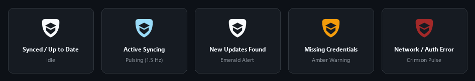
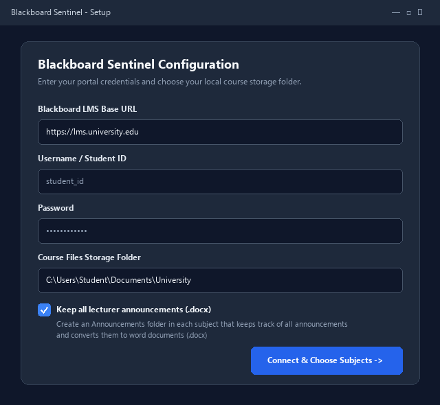
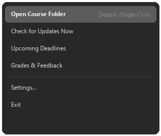

# Blackboard Sentinel

An automated course synchronizer and tracker for **Blackboard Learn Ultra** portals.

Monitors university courses in the background, automatically organizes downloaded slides/materials and assignment files into clean subject folders, and alerts you via instant messaging (Hermes Agent / WhatsApp) and native Windows toast notifications when new grades, announcements, materials, or upcoming deadlines appear.

---

## Features

- **Dynamic Course Discovery**: Automatically inspects enrolled courses directly via Blackboard's REST API and creates course folders named after each course.
- **Dual-Source Content Discovery**:
  - Traverses standard content folders, learning modules, and slide attachments and downloads files in the same order they appear on the online portal.
  - Inspects assignment instructions and tests (`data-bbfile` JSON payloads) to extract homework files and project briefs that naive scrapers miss.
- **Authoritative Deadline Tracking**: Merges Blackboard calendar items with the gradebook's authoritative `grading.due` column, clamping requests to avoid API date-window drops.
- **Grade & Feedback Sentinel**: Tracks grade releases, score updates, status transitions (`NeedsGrading` -> `Graded`), and instructor feedback comments.
- **Parallel Course Checking**: Courses, gradebook columns, and grades are fetched on a small thread pool (`LMS_MAX_WORKERS`, default 0 = unlimited; set to 1 for sequential on very old single-core machines).
- **Optional Size Cap**: Set `LMS_MAX_FILE_SIZE_MB` (or use the Settings window) to skip files above a given size. Disabled by default (`0`); skipped files are retried automatically if you raise the limit.
- **Minimal Resource Footprint**:
  - **Windows Tray App**: Sits idle in the notification area at only ~25–35 MB RAM.
  - **Hermes Agent & Linux**: **0 MB** idle RAM (runs on-demand via `hermes cron`, taking ~18 MB for 3–5 seconds during checks and terminating immediately).
- **Zero-Quota & Silent**: Operates purely with standard Python HTTP requests. Dispatches notifications when updates are found.
  - **Windows System Tray App**: Sits in notification area as a real-time status indicator with dynamic state tinting, waiting animation, and quick-action menu.
  - **Windows Headless Background Task**: Runs silently via Windows Task Scheduler with zero RAM footprint when idle.
  - **Hermes Agent & Linux**: 24/7 background scheduler (`hermes cron`) inside WSL/Ubuntu with chat push notifications (WhatsApp / origin routing).
  - **Standalone CLI**: Runs on-demand from any terminal.

---

## Performance & Speed Metrics

All timings reflect real, end-to-end measurements taken on live Blackboard REST infrastructure across enrolled courses:

| Operation | Typical Duration | Details |
| :--- | :--- | :--- |
| **Routine Check (Nothing Changed)** | **~25 – 35s** | Authenticates, queries enrolled courses, recursively walks folder trees for newly published items, checks all gradebook columns & instructor feedback, and validates deadlines against local cache. |
| **Delta Check (Changes Detected)** | **~30 – 45s** | Traverses course trees, downloads newly posted slides/attachments into `Announcements/` or course folders, converts announcements to `.docx`, and dispatches Windows notifications and WhatsApp chat alerts. |
| **First-Time Run (Cold Start)** | **~45 – 90s** | Initial authentication, dynamic course discovery, folder structure mirroring on disk, and bulk download of all existing course materials, assignments, and announcements. |
| **Quick CLI Helper (`lms_deadlines` / `lms_grades`)** | **~1.5 – 4.5s** | Targeted single-endpoint queries directly fetching upcoming deadlines (~1.5s) or gradebook entries (~4.3s) without recursive content tree walks. |

- **Check Timing Breakdown (Routine ~31.5s Cycle)**:
  - Authentication (REST + Cookies): ~2.0s
  - Course mapping: ~1.4s
  - Recursive folder & announcement traversal: ~22.3s
  - Gradebook columns & feedback checks: ~4.3s
  - Deadlines & calendar sync: ~1.5s
- **Memory Footprint**:
  - **Windows System Tray App**: ~25–35 MB private working set when idling in the system tray.
  - **Hermes Agent & Headless Linux**: **0 MB** idle RAM (executes on-demand via cron schedule, using ~18 MB for brief checks and terminating immediately).

---

## Project Structure

```text
blackboard-sentinel/
├── check_lms.py          # Main sentinel engine (syncs files, tracks deadlines & grades)
├── lms_deadlines.py      # Quick CLI helper for upcoming deadlines
├── lms_grades.py         # Quick CLI helper for recent grades & feedback
├── cli.py                # Console runner (BlackboardSentinelCLI.exe) with simple subcommands
├── tray_app.py           # Windows System Tray resident application
├── tray_icon.py          # State-driven tinting and animation engine
├── install.ps1           # Windows installer (Tray App or Task Scheduler)
├── uninstall.ps1         # Windows uninstaller
├── install.sh            # Linux / Hermes Agent installer
├── requirements.txt      # Python dependencies
├── .env.example          # Environment variable template
├── assets/
│   ├── icon_base.svg     # Master white base vector icon
│   ├── icon_base.png     # High-resolution (512x512) transparent base PNG
│   └── icon_base.ico     # Multi-resolution Windows icon
├── scripts/
│   └── generate_icon_png.py # Mathematical vector icon rasterizer
└── skill/
    └── SKILL.md          # Hermes Agent skill definition
```

---

## Tray Icon & Dynamic States

Blackboard Sentinel runs quietly in your notification area as an active status indicator with real-time breathing animations:

<p align="center">
  
</p>

---

## Interface & Configuration

<p align="center">
  
  &nbsp;&nbsp;
  
</p>

- **Setup & Configuration**: A clean, 2-step dark GUI with portal connection testing, course discovery, and automatic `.env` credential storage.
- **System Tray Quick Menu**: Single-clicking the tray icon immediately opens your local course folder in File Explorer. Right-clicking accesses manual sync, upcoming deadlines, grades viewer, settings, and exit.

---

## Quick Start

### 1. Windows Installation (Recommended)

1. **Download the Setup Executable**:
   Download **`BlackboardSentinelSetup.exe`** from the [Latest Release](https://github.com/7adel32/blackboard-sentinel/releases/latest).

2. **Run the Installer**:
   Double-click `BlackboardSentinelSetup.exe` and click **Install / Update**.

*(Alternative: install from source via PowerShell)*:
```powershell
powershell -ExecutionPolicy Bypass -File .\install.ps1
```

To uninstall:
- Go to Windows **Settings -> Apps -> Installed apps -> Blackboard Sentinel -> Uninstall**, or
- Run **Uninstall Blackboard Sentinel** from your Start Menu, or
- Run `uninstall.exe` directly from `%LOCALAPPDATA%\Programs\BlackboardSentinel\`

---

### 2. macOS Menu Bar Application ("Tray" Port)

Blackboard Sentinel runs natively in the **macOS Menu Bar** as a lightweight accessory item (`LSUIElement`) with Dark/Light appearance detection, dynamic state tinting, native macOS notifications (`osascript`), and auto-launch support.

#### Quick Setup on macOS:
```bash
git clone https://github.com/7adel32/blackboard-sentinel.git
cd blackboard-sentinel
chmod +x install_mac.sh uninstall_mac.sh
./install_mac.sh
```

The script configures a dedicated virtualenv, installs required macOS framework bindings (`pyobjc`), sets up a user `LaunchAgent` (`~/Library/LaunchAgents/com.sentinel.blackboard.plist`), and launches the application.

#### Packaging into a standalone `.app` bundle:
```bash
pip install pyinstaller
pyinstaller BlackboardSentinel_mac.spec
```
This produces `dist/BlackboardSentinel.app` ready to drop into `/Applications`.

---

### 3. Standalone Manual CLI (Cross-Platform)

For headless servers, Linux, or command-line usage without the desktop tray:

1. **Clone the repository:**
   ```bash
   git clone https://github.com/7adel32/blackboard-sentinel.git
   cd blackboard-sentinel
   pip install -r requirements.txt
   ```

2. **Configure credentials:**
   ```bash
   cp .env.example .env
   ```
   Edit `.env` with your portal details:
   ```env
   LMS_URL="https://lms.university.edu"
   LMS_USER_ID="your_student_id"
   LMS_PASSWORD="your_password"
   LMS_STORAGE_DIR="~/Documents/University"
   ```

3. **Run on-demand:**
   ```bash
   # Check updates and sync course materials:
   python check_lms.py --manual

   # View upcoming deadlines:
   python lms_deadlines.py

   # View grades and feedback:
   python lms_grades.py
   ```

---

## 24/7 Chat & Mobile Notifications via Hermes Agent (Optional)

If you run [Hermes Agent](https://github.com/NousResearch/hermes-agent) on Linux or WSL with messaging configured (e.g. WhatsApp), you can run Sentinel as an automated 24/7 background watchdog:

```bash
chmod +x install.sh && ./install.sh
```

The installer:
1. Prompts for credentials (or reads existing `.env` from `~/.hermes/.env`).
2. Copies sentinel scripts to `~/.hermes/scripts/`.
3. Installs the `university-portal` skill to `~/.hermes/skills/`.
4. Automatically registers an hourly cron job (`lms-sentinel`) with `--deliver origin` delivery (defaulting to WhatsApp).

---

## Command-Line Runner (for scripts and agents)

`BlackboardSentinelCLI.exe` is a console build with plain subcommands, so scripts and automated agents never need to drive the tray app or its windows. It is installed next to the tray app by the setup installer.

| Command | What it does |
| :--- | :--- |
| `BlackboardSentinelCLI status [--json]` | Show configuration state and cached deadline count (no network) |
| `BlackboardSentinelCLI check` | Run a full sync now |
| `BlackboardSentinelCLI deadlines [--json] [--notify]` | Upcoming deadlines with `SUBMITTED` / `NOT SUBMITTED` status |
| `BlackboardSentinelCLI grades [--json] [--notify]` | Current grades and feedback |
| `BlackboardSentinelCLI courses [--json]` | Monitored courses |

Exit code is `0` on success and `1` on error, with a single `ERROR: ...` line on stderr.

---

## Configuration Reference

| Environment Variable | Description | Default |
| :--- | :--- | :--- |
| `LMS_URL` | Base URL of your Blackboard portal (e.g. `https://lms.university.edu`) | *Required* |
| `LMS_USER_ID` | Student login username or ID number | *Required* |
| `LMS_PASSWORD` | Student login password | *Required* |
| `LMS_STORAGE_DIR` | Local root directory for downloaded course materials | `~/Documents/University` |
| `LMS_STUDENT_ID` | Internal Blackboard user ID (auto-detected if omitted) | Auto-detected |
| `LMS_EXPAND_ZIPS` | Smartly decompress newly imported `.zip` files into `<name>_zip` (or directly for descriptive single documents), collapsing redundant wrapper folders and keeping empty/encrypted archives zipped (compute intensive — not suitable for low-power machines) | `false` |
| `LMS_DELETE_ORIGINAL_ZIP` | Delete the original `.zip` archive after decompression (when `LMS_EXPAND_ZIPS` is enabled) | `false` |
| `HERMES_CHAT_PLATFORM` | Messaging platform for notifications via Hermes (`whatsapp`, `telegram`) | `whatsapp` |

---

## License

MIT License. See [LICENSE](LICENSE) for details.
